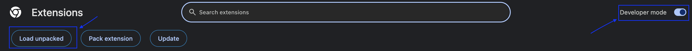
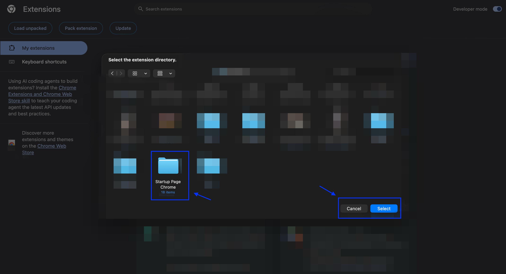
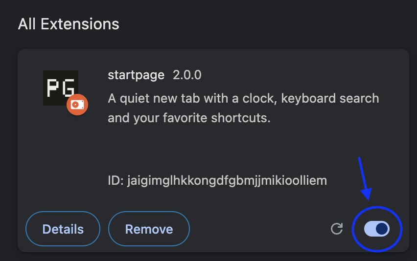

# Startpage — A Minimal New Tab Extension for Chrome

A quiet, keyboard-driven new tab replacement for Google Chrome that puts a live clock, personalized greetings, quick shortcuts, weather and a smart search bar right at your fingertips. With default settings, a new tab runs offline.

---

## ✨ Features

### 🕐 Live Clock & Personalized Greetings
- Real-time clock with **12-hour** or **24-hour** format
- Configurable **time zone** support (any IANA zone, e.g. `Asia/Kolkata`, `America/New_York`)
- **49 personal greetings** across seven times of day. Each period gets a different line the next day in your selected time zone.
- Personalize greetings with your name, or set a custom message

### 🔍 Smart Search Bar
- Search with your preferred engine: **Google**, **DuckDuckGo**, **Bing**, **Brave**, **Yandex**, **Qwant**, **Yahoo**, **Ecosia**, **Startpage (search engine)**, and **Baidu**
- **Shortcut aliases** — type `yt` for YouTube, `g` for GitHub, `r` for Reddit, and many more
- **Site-specific commands**:
  - `yt?jazz` → Search YouTube for "jazz"
  - `r/chrome` → Open the r/chrome subreddit
  - `g/username` → Go to a GitHub profile
- **Inline calculator** — type arithmetic like `12 × (3 + 2)` and get instant results
- **Direct URL navigation** — type any URL and go straight there
- **Autocomplete suggestions** ranked by exact match → prefix → substring → category
- **Brand preview** — the background animates with the selected site's colors as you type
- Type `--settings` in the search bar to open settings

### 📌 Pinnable Shortcuts
- Pin your favorite sites to the main page for one-click access
- **20+ built-in shortcuts** across categories: YouTube, GitHub, Reddit, Gmail, Spotify, Discord, WhatsApp, Telegram, Instagram, Twitter, Netflix, LinkedIn, Stack Overflow, ChatGPT, Wikipedia, Amazon, Google Drive, Translate, and more
- **Add your own custom shortcuts** with a name and URL through the Shortcuts library
- **Filter and manage** all shortcuts from the library dialog (`Ctrl+K` on Windows or `⌘K` on Mac)

### ⌨️ Keyboard-First Navigation
| Shortcut | Action |
|---|---|
| `/` | Focus the search bar |
| `Ctrl+K` (Windows) or `⌘K` (Mac) | Open the shortcuts library. `Alt+K` / `⌥K` also works. |
| `Ctrl/⌘ + ,` | Open settings |
| `Shift + Key` | Jump directly to a shortcut (e.g. `Shift + G` → GitHub) |
| `↑` / `↓` | Navigate search suggestions |
| `Enter` | Open selected suggestion |
| `Ctrl/⌘ + Enter` | Force a web search with the typed text |
| `Escape` | Clear search / close dialogs |

### 🌦️ Weather (Opt-In)
- Powered by [Open-Meteo](https://open-meteo.com/) — **free, no API key required**
- Shows current temperature and conditions for your configured city
- Supports **Celsius** and **Fahrenheit**
- 30-minute smart cache with graceful offline fallback (cached data shown up to 24 hours with a "cached" label)

### 🏔️ Animated Pixel-Art Landscape
- A charming mountain scene rendered on an HTML canvas beside the clock
- **Sun tracks across the sky** based on real sunrise/sunset data from your weather city
- **Dawn and dusk transitions** with color changes
- **Weather-reactive animations**: clouds, fog, rain, drizzle, snow, thunderstorms with lightning, and hail
- Stars and a crescent moon at night, with twinkling effects
- Birds glide across clear day skies; wind streaks appear during strong winds
- Respects the **prefers-reduced-motion** system setting (shows a still illustration)
- Pauses rendering when the tab is hidden to save resources

### 🎨 Themes & Customization
- **Pixel** (default) uses pixel lettering and icons. **Original** restores the smooth interface, **Editorial** pairs serif headings with simple shortcuts, **Terminal** uses green accents and monospace type, and **Glass** uses a soft gradient in light and dark. **macOS Terminal** adds a traffic-light title bar and monospace prompt. **Vintage Windows** uses a teal desktop, striped window headers, and folder-shaped shortcuts.
- Set **Color scheme** to Dark, Light, or System for any theme.
- **Custom colors** — override individual UI element colors (background, search bar, greeting text, tiles, etc.)
- Switch between both layouts in **Settings → General → New-tab layout**.
  - **Startpage** (default) — the modern desk layout with clock, search, and pins
  - **Classic Chevron** — the original launcher interface with themes, history, and optional AI/currency tools

### Homepage widgets & wallpaper

Open **Settings → Homepage** in Startpage. Enable **To-do list** to add reminders with optional due dates, or **Notes** for a scratchpad that saves as you type. Both widgets start turned off. Drag a widget by its dotted handle or focus the handle and press the arrow keys to move it. When the window is too narrow, scroll down to reach the widgets below the pins.

Choose a picture from your device to set the homepage background in your selected color scheme. Typing a search brings up its animated brand background. Your picture, widget positions, notes and reminders stay in this browser profile. The JSON backup covers shared settings.

### Settings & backup

Type a word like **history**, **wallpaper**, **API key** or **clock** in **Find a setting** to edit matching controls. Press Enter to focus a match and Escape to clear the finder. You can also browse by topic. Save applies the whole draft, including edits made in different sections.

- Shared preferences sync across devices via **Chrome Sync Storage**. Classic’s launcher preferences, chat key and search history stay on this device.
- **Export** your configuration as a JSON file
- **Import** a previously exported JSON backup
- Edit the raw configuration JSON in an advanced editor
- Settings are drafted before saving — canceling reverts all changes
- Changes reflect instantly across all open new tabs

### 🔒 Privacy-Focused
- **Zero network requests** on a fresh tab (weather is opt-in)
- No analytics, no tracking, no telemetry
- Only requires the `storage` Chrome permission
- All shortcut icons and fonts are bundled locally

---

## Independence and network use

The Startpage desk, Settings, widgets and search suggestions run locally. The clock uses the device and browser time-zone database. Optional weather uses Open-Meteo. Classic Chevron, its libraries and both fonts are packaged with the extension. GitHub and npm are unnecessary to run an unpacked copy.

Classic’s **Online tools** section controls two optional external services. Live conversions use the fawazahmed0 currency dataset via jsDelivr. AI chat sends an explicitly submitted prompt to OpenAI using the configured key. Both start off in a new profile. Following a shortcut or submitting a web search opens the chosen site. Development uses Playwright for browser tests. [Full inventory](THIRD_PARTY_NOTICES.txt)

Chrome opens the new-tab override from an internal address such as `chrome-extension://<id>/index.html`. The ID belongs to the installation. For this unpacked project without a manifest key, Chrome derives it from the absolute folder path. The manifest sets the display name and developer. [Chrome’s extension ID documentation](https://developer.chrome.com/docs/extensions/reference/manifest/key)

## 🚀 Installation

### Step 1 — Get the Source Code

You can get the project by **cloning the repository** or **downloading it as a ZIP**.

#### Option A: Clone with Git (Recommended)

Open a terminal and run:

```bash
git clone https://github.com/Prashant9683/Chrome-Startup-Page.git
```

This will create a `Chrome-Startup-Page` directory containing the `Startup Page Chrome` extension folder.

#### Option B: Download as ZIP

1. Go to the GitHub repository: [https://github.com/Prashant9683/Chrome-Startup-Page](https://github.com/Prashant9683/Chrome-Startup-Page)
2. Click the green **"<> Code"** button, then click **"Download ZIP"**
3. Extract/unzip the downloaded file. Inside, you will find the `Startup Page Chrome` folder.

> [!IMPORTANT]
> - Make sure you **extract the ZIP** before proceeding. Chrome cannot load a `.zip` file directly.
> - The extension directory to load is the inner **`Startup Page Chrome`** folder (where `manifest.json` is located), **not** the parent repository folder.

---

### Step 2 — Enable Developer Mode & Load the Extension

Open **Google Chrome** and navigate to `chrome://extensions`. Turn on **Developer mode** using the toggle in the top-right corner, then click the **"Load unpacked"** button.



### Step 3 — Select the "Startup Page Chrome" Folder

In the file picker, navigate inside the cloned or unzipped repository and select the **`Startup Page Chrome`** folder (the one containing `manifest.json`), then click **Select**.

> [!IMPORTANT]
> Be sure to select the inner **`Startup Page Chrome`** subfolder, not the parent `Chrome-Startup-Page` directory.



### Step 4 — Verify Installation & Keep It Enabled

The extension should now appear in your extensions list. Make sure the **toggle is enabled** so it stays active. Open a new tab to see your new Startpage!



> [!TIP]
> After any update to the extension files (e.g. after a `git pull`), go back to `chrome://extensions` and click the **Reload** (↻) button on the Startpage card, then open a new tab to see your changes.

---

## ⚙️ Configuration

Click the **⚙ gear icon** in the top-right of the new tab page (or press `Ctrl/⌘ + ,`) to open Settings, where you can configure:

| Setting | Options |
|---|---|
| **Name** | Your name for personalized greetings |
| **Search engine** | Google, DuckDuckGo, Bing, Brave, Yandex, Qwant, Yahoo, Ecosia, Startpage, Baidu |
| **Theme** | Pixel, Original, Editorial, Terminal, Glass, macOS Terminal, Vintage Windows |
| **Color scheme** | Dark, Light, System, or saved custom colors |
| **Clock format** | 12-hour or 24-hour |
| **Time zone** | Any IANA time zone, or leave blank for device default |
| **Show greeting** | Toggle the time-aware greeting message |
| **Open shortcuts in a new tab** | Control default link behavior |
| **Show weather** | Enable weather with a city and temperature unit |
| **Homepage widgets & wallpaper** | To-do list, Notes and a local background image for Startpage |
| **New-tab layout** | Startpage (default) or Classic Chevron |

### Default Configuration

Out of the box, Startpage comes with:
- **Pixel** theme with the **Dark** color scheme
- **12-hour** clock using your device's time zone
- **Google** as the default search engine
- Six pinned shortcuts: GitHub, YouTube, Gmail, Reddit, Spotify, Google Drive
- Weather **disabled** (no network requests on startup)

---

## 🧪 Running Tests

Requires [Node.js](https://nodejs.org/) 22 or newer. Navigate into the extension folder first:

```bash
cd "Startup Page Chrome"

# Run unit tests
npm test

# Run browser tests (requires Chromium)
npm ci
npx playwright-core install chromium
npm run test:browser
```

**Environment variables for browser tests:**

| Variable | Description |
|---|---|
| `LIVE_SERVICES=1` | Enable live weather and exchange-rate checks |
| `CHROMIUM_PATH` | Path to an existing Chrome for Testing executable |
| `SCREENSHOT_DIR` | Directory to save tested desktop and narrow layout screenshots |

---

## 📁 Project Structure

```
Chrome-Startup-Page/                      # Root repository
└── Startup Page Chrome/                 # Extension directory (load this in Chrome)
    ├── manifest.json                    # Chrome Extension manifest (Manifest V3)
    ├── index.html                       # Main new-tab page (Startpage desk layout)
    ├── config.json                      # Default user preferences
    ├── config.js                        # Built-in shortcut catalog & search engine definitions
    ├── icons.js                         # Bundled SVG icons for all shortcuts
    ├── js/
    │   ├── main.js                      # App entry point — orchestrates all modules
    │   ├── search.js                    # Shortcut matching, command routing & web search
    │   ├── autocomplete.js              # Search bar UI, suggestion list & keyboard navigation
    │   ├── calculator.js                # Inline arithmetic parser
    │   ├── clock.js                     # Live clock, date & time-aware greetings
    │   ├── weather.js                   # Open-Meteo weather fetching & caching
    │   ├── landscape.js                 # Animated pixel-art mountain canvas
    │   ├── brand.js                     # Brand color preview backgrounds
    │   ├── library.js                   # Shortcuts library dialog (filter, pin, add, edit)
    │   ├── settings.js                  # Settings dialog & JSON backup controls
    │   ├── preferences.js               # Config validation, Chrome sync read/write
    │   ├── version.js                   # Reads version from manifest
    │   ├── classic.js                   # Classic Chevron layout entry point
    │   └── classic-services.js          # Classic layout optional services
    ├── css/
    │   ├── main.css                     # Startpage desk layout styles
    │   ├── pixels.css                   # Pixel font and dot-grid styles
    │   └── themes.css                   # Theme palettes, fonts, icons and controls
    ├── img/
    │   └── icon64.png                   # Extension icon
    ├── guide_images/                    # Installation guide screenshots
    ├── script.js                        # Original Chevron launcher (bundled)
    ├── style.css                        # Original Chevron styles (bundled)
    ├── tests/                           # Unit & browser test suites
    └── IMPROVEMENT_PLAN.md              # Architecture notes & verification log
```

---

## 📜 License

Copyright © 2026 Prashant Gehlot. [Startpage license](LICENSE)

Developed by **Prashant Gehlot**. The original Startpage code is MIT-licensed. Classic Chevron and the bundled typefaces carry their own credits and license notices. [Credits and dependency inventory](THIRD_PARTY_NOTICES.txt)
